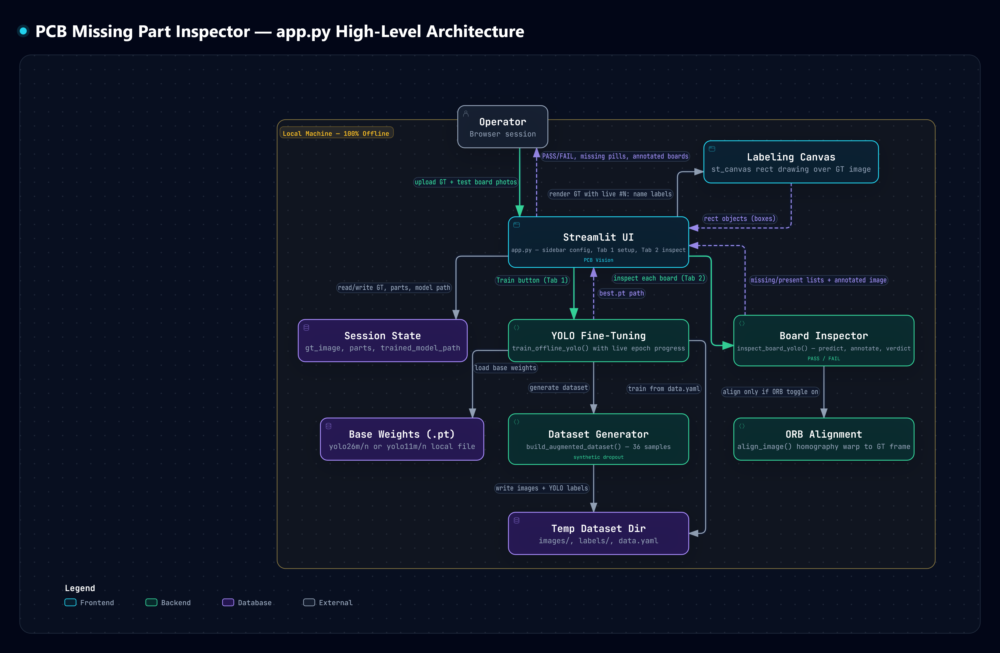

## Trade Offs:
- Using YOLO instead of SSIM added the cost and time of training the model before use but greatly increased the accuracy of the bounding boxes.
- SSIM is faster but YOLO is more accurate and robust to the lighting changes that may occur because of the absence of some parts.

## Archify Diagram:
